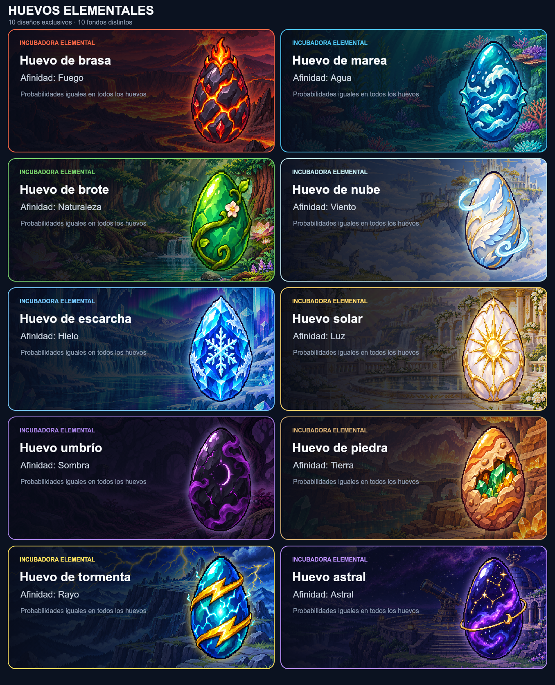
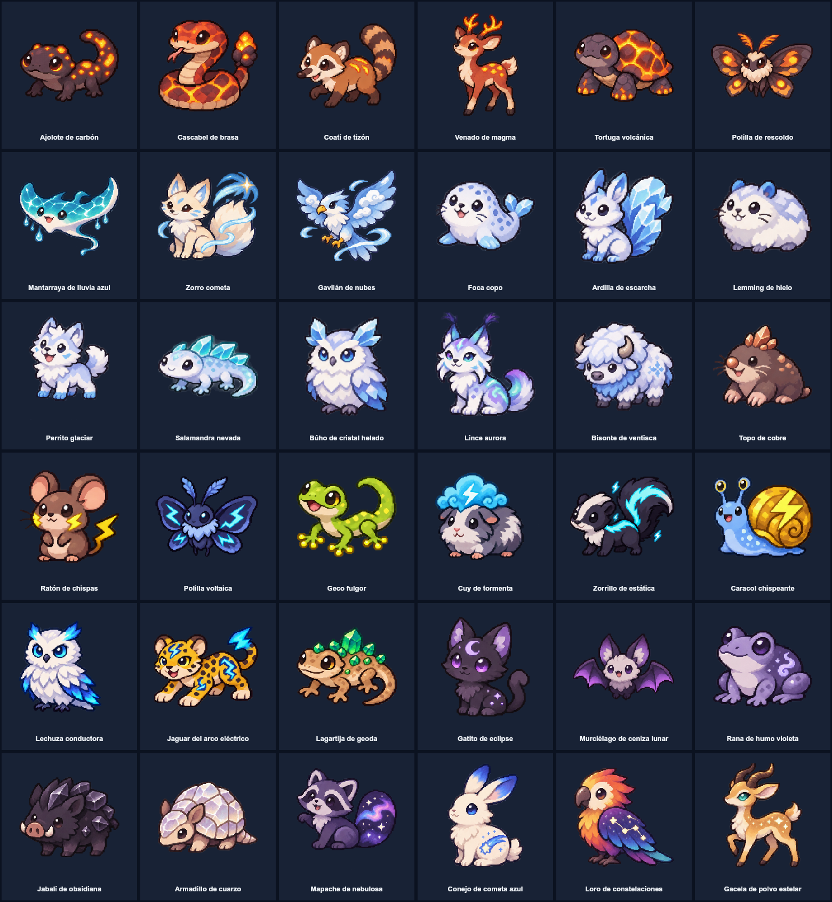

# Catálogo balanceado de huevos elementales

Los diez huevos tienen **15 especies cada uno**. Cada huevo mantiene la misma composición: **8 comunes, 4 poco comunes, 1 rara, 1 épica y 1 legendaria**. El sistema primero sortea la rareza con la misma probabilidad en todos los huevos y luego elige al azar una especie de ese nivel.

## Diseños de huevos y fondos

Cada elemento tiene una ilustración de huevo y un fondo únicos.

## Balance por huevo

| Huevo | Elemento | Mascotas | Común | Poco común | Raro | Épico | Legendario |
|---|---|---:|---:|---:|---:|---:|---:|
| Huevo de brasa | Fuego | 15 | 8 | 4 | 1 | 1 | 1 |
| Huevo de marea | Agua | 15 | 8 | 4 | 1 | 1 | 1 |
| Huevo de brote | Naturaleza | 15 | 8 | 4 | 1 | 1 | 1 |
| Huevo de nube | Viento | 15 | 8 | 4 | 1 | 1 | 1 |
| Huevo de escarcha | Hielo | 15 | 8 | 4 | 1 | 1 | 1 |
| Huevo solar | Luz | 15 | 8 | 4 | 1 | 1 | 1 |
| Huevo umbrío | Sombra | 15 | 8 | 4 | 1 | 1 | 1 |
| Huevo de piedra | Tierra | 15 | 8 | 4 | 1 | 1 | 1 |
| Huevo de tormenta | Rayo | 15 | 8 | 4 | 1 | 1 | 1 |
| Huevo astral | Astral | 15 | 8 | 4 | 1 | 1 | 1 |
| **Total** |  | **150** | **80** | **40** | **10** | **10** | **10** |

## Probabilidades de rareza

| Rareza | Probabilidad en cada huevo |
|---|---:|
| Común | 58% |
| Poco común | 25% |
| Raro | 11% |
| Épico | 5% |
| Legendario | 1% |

Como la cantidad de especies de cada rareza también coincide en los diez huevos, la probabilidad de obtener una especie concreta de la misma rareza es igual entre elementos.

## Especies nuevas y sprites individuales

| Huevo | Rareza | Mascota | Sprite individual |
|---|---|---|---|
| Brasa · Fuego | Común | Ajolote de carbón | [PNG](pets/ajolote-de-carbon.png) |
| Brasa · Fuego | Común | Cascabel de brasa | [PNG](pets/cascabel-de-brasa.png) |
| Brasa · Fuego | Común | Coatí de tizón | [PNG](pets/coati-de-tizon.png) |
| Brasa · Fuego | Poco común | Venado de magma | [PNG](pets/venado-de-magma.png) |
| Brasa · Fuego | Poco común | Tortuga volcánica | [PNG](pets/tortuga-volcanica.png) |
| Brasa · Fuego | Poco común | Polilla de rescoldo | [PNG](pets/polilla-de-rescoldo.png) |
| Marea · Agua | Poco común | Mantarraya de lluvia azul | [PNG](pets/mantarraya-de-lluvia-azul.png) |
| Nube · Viento | Poco común | Zorro cometa | [PNG](pets/zorro-cometa.png) |
| Nube · Viento | Poco común | Gavilán de nubes | [PNG](pets/gavilan-de-nubes.png) |
| Escarcha · Hielo | Común | Foca copo | [PNG](pets/foca-copo.png) |
| Escarcha · Hielo | Común | Ardilla de escarcha | [PNG](pets/ardilla-de-escarcha.png) |
| Escarcha · Hielo | Común | Lemming de hielo | [PNG](pets/lemming-de-hielo.png) |
| Escarcha · Hielo | Común | Perrito glaciar | [PNG](pets/perrito-glaciar.png) |
| Escarcha · Hielo | Común | Salamandra nevada | [PNG](pets/salamandra-nevada.png) |
| Escarcha · Hielo | Común | Búho de cristal helado | [PNG](pets/buho-de-cristal-helado.png) |
| Escarcha · Hielo | Poco común | Lince aurora | [PNG](pets/lince-aurora.png) |
| Escarcha · Hielo | Poco común | Bisonte de ventisca | [PNG](pets/bisonte-de-ventisca.png) |
| Piedra · Tierra | Común | Topo de cobre | [PNG](pets/topo-de-cobre.png) |
| Tormenta · Rayo | Común | Ratón de chispas | [PNG](pets/raton-de-chispas.png) |
| Tormenta · Rayo | Común | Polilla voltaica | [PNG](pets/polilla-voltaica.png) |
| Tormenta · Rayo | Común | Geco fulgor | [PNG](pets/geco-fulgor.png) |
| Tormenta · Rayo | Común | Cuy de tormenta | [PNG](pets/cuy-de-tormenta.png) |
| Tormenta · Rayo | Común | Zorrillo de estática | [PNG](pets/zorrillo-de-estatica.png) |
| Tormenta · Rayo | Común | Caracol chispeante | [PNG](pets/caracol-chispeante.png) |
| Tormenta · Rayo | Común | Lechuza conductora | [PNG](pets/lechuza-conductora.png) |
| Tormenta · Rayo | Poco común | Jaguar del arco eléctrico | [PNG](pets/jaguar-del-arco-electrico.png) |
| Piedra · Tierra | Común | Lagartija de geoda | [PNG](pets/lagartija-de-geoda.png) |
| Umbrío · Sombra | Común | Gatito de eclipse | [PNG](pets/gatito-de-eclipse.png) |
| Umbrío · Sombra | Común | Murciélago de ceniza lunar | [PNG](pets/murcielago-de-ceniza-lunar.png) |
| Umbrío · Sombra | Común | Rana de humo violeta | [PNG](pets/rana-de-humo-violeta.png) |
| Piedra · Tierra | Poco común | Jabalí de obsidiana | [PNG](pets/jabali-de-obsidiana.png) |
| Piedra · Tierra | Poco común | Armadillo de cuarzo | [PNG](pets/armadillo-de-cuarzo.png) |
| Astral · Astral | Común | Mapache de nebulosa | [PNG](pets/mapache-de-nebulosa.png) |
| Astral · Astral | Común | Conejo de cometa azul | [PNG](pets/conejo-de-cometa-azul.png) |
| Astral · Astral | Poco común | Loro de constelaciones | [PNG](pets/loro-de-constelaciones.png) |
| Astral · Astral | Poco común | Gacela de polvo estelar | [PNG](pets/gacela-de-polvo-estelar.png) |

## Mascotas reclasificadas para igualar los grupos

| Elemento | Mascota | Rareza anterior | Rareza nueva |
|---|---|---|---|
| Naturaleza | Liebre de panal | Común | Poco común |
| Naturaleza | Erizo naranjo | Común | Poco común |
| Luz | Caracol vitral | Común | Poco común |
| Viento | Camaleón del viento | Raro | Común |
| Sombra | Basilisco pequeño | Raro | Común |
| Astral | Medusa lunar | Raro | Común |
| Astral | Ardilla cometa | Épico | Común |

La reclasificación afecta nuevas adopciones. Las mascotas que ya están guardadas en perfiles conservan sus datos actuales.
