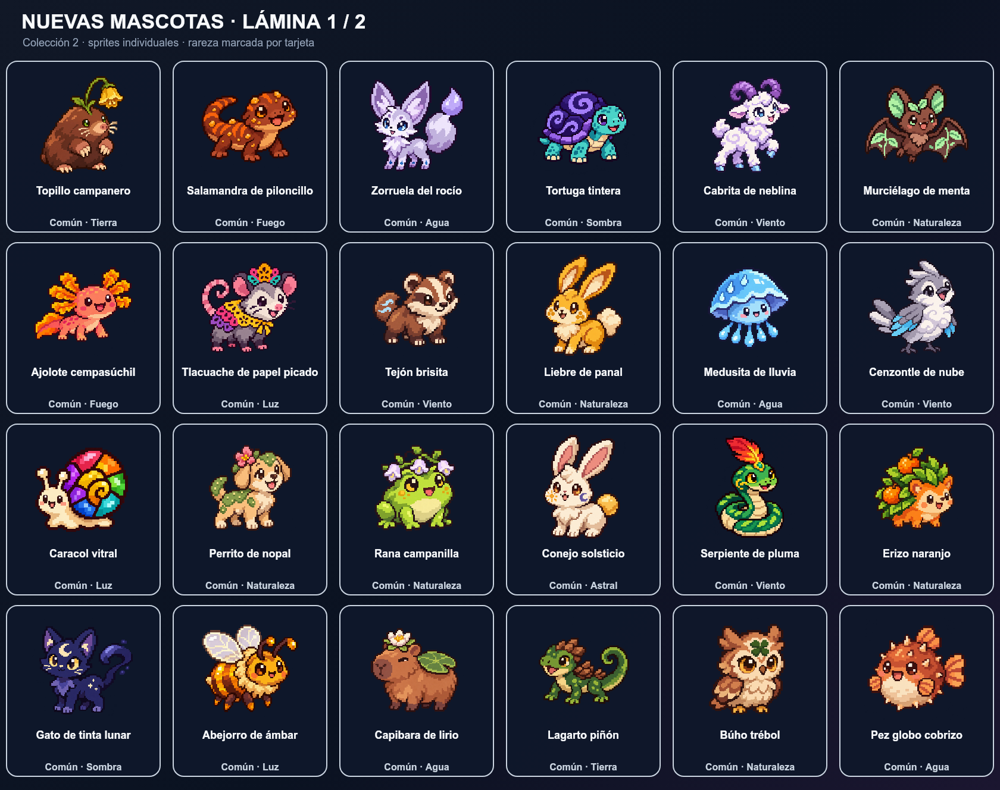
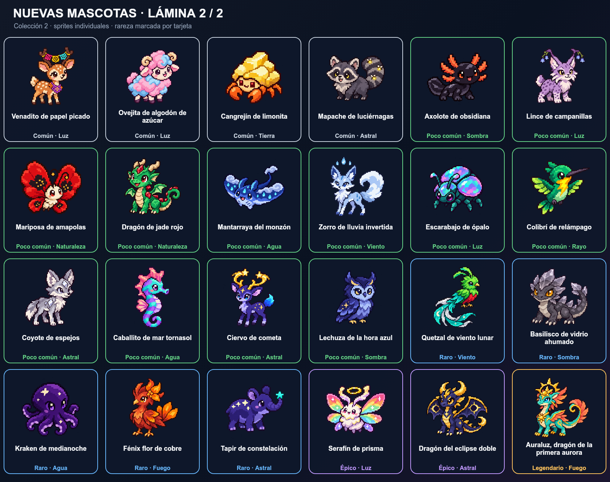

# Catálogo de mascotas · Colección 2

Colección nueva de 48 especies, integrada al catálogo RPG. Las rarezas conservan la distribución de la primera colección: **28 comunes, 12 poco comunes, 5 raras, 2 épicas y 1 legendaria**.

## Común (28)

| Mascota | Elemento | Especialidad | Sprite individual |
|---|---|---|---|
| Topillo campanero | Tierra | Explorador | [PNG](pets/topillo-campanero.png) |
| Salamandra de piloncillo | Fuego | Atacante | [PNG](pets/salamandra-de-piloncillo.png) |
| Zorruela del rocío | Agua | Explorador | [PNG](pets/zorruela-del-rocio.png) |
| Tortuga tintera | Sombra | Guardián | [PNG](pets/tortuga-tintera.png) |
| Cabrita de neblina | Viento | Apoyo | [PNG](pets/cabrita-de-neblina.png) |
| Murciélago de menta | Naturaleza | Explorador | [PNG](pets/murcielago-de-menta.png) |
| Ajolote cempasúchil | Fuego | Apoyo | [PNG](pets/ajolote-cempasuchil.png) |
| Tlacuache de papel picado | Luz | Apoyo | [PNG](pets/tlacuache-de-papel-picado.png) |
| Tejón brisita | Viento | Guardián | [PNG](pets/tejon-brisita.png) |
| Liebre de panal | Naturaleza | Apoyo | [PNG](pets/liebre-de-panal.png) |
| Medusita de lluvia | Agua | Místico | [PNG](pets/medusita-de-lluvia.png) |
| Cenzontle de nube | Viento | Apoyo | [PNG](pets/cenzontle-de-nube.png) |
| Caracol vitral | Luz | Guardián | [PNG](pets/caracol-vitral.png) |
| Perrito de nopal | Naturaleza | Apoyo | [PNG](pets/perrito-de-nopal.png) |
| Rana campanilla | Naturaleza | Místico | [PNG](pets/rana-campanilla.png) |
| Conejo solsticio | Astral | Explorador | [PNG](pets/conejo-solsticio.png) |
| Serpiente de pluma | Viento | Atacante | [PNG](pets/serpiente-de-pluma.png) |
| Erizo naranjo | Naturaleza | Guardián | [PNG](pets/erizo-naranjo.png) |
| Gato de tinta lunar | Sombra | Explorador | [PNG](pets/gato-de-tinta-lunar.png) |
| Abejorro de ámbar | Luz | Apoyo | [PNG](pets/abejorro-de-ambar.png) |
| Capibara de lirio | Agua | Guardián | [PNG](pets/capibara-de-lirio.png) |
| Lagarto piñón | Tierra | Explorador | [PNG](pets/lagarto-pinon.png) |
| Búho trébol | Naturaleza | Místico | [PNG](pets/buho-trebol.png) |
| Pez globo cobrizo | Agua | Guardián | [PNG](pets/pez-globo-cobrizo.png) |
| Venadito de papel picado | Luz | Apoyo | [PNG](pets/venadito-de-papel-picado.png) |
| Ovejita de algodón de azúcar | Luz | Apoyo | [PNG](pets/ovejita-de-algodon-de-azucar.png) |
| Cangrejín de limonita | Tierra | Guardián | [PNG](pets/cangrejin-de-limonita.png) |
| Mapache de luciérnagas | Astral | Explorador | [PNG](pets/mapache-de-luciernagas.png) |

## Poco común (12)

| Mascota | Elemento | Especialidad | Sprite individual |
|---|---|---|---|
| Axolote de obsidiana | Sombra | Apoyo | [PNG](pets/axolote-de-obsidiana.png) |
| Lince de campanillas | Luz | Explorador | [PNG](pets/lince-de-campanillas.png) |
| Mariposa de amapolas | Naturaleza | Místico | [PNG](pets/mariposa-de-amapolas.png) |
| Dragón de jade rojo | Naturaleza | Atacante | [PNG](pets/dragon-de-jade-rojo.png) |
| Mantarraya del monzón | Agua | Guardián | [PNG](pets/mantarraya-del-monzon.png) |
| Zorro de lluvia invertida | Viento | Explorador | [PNG](pets/zorro-de-lluvia-invertida.png) |
| Escarabajo de ópalo | Luz | Guardián | [PNG](pets/escarabajo-de-opalo.png) |
| Colibrí de relámpago | Rayo | Apoyo | [PNG](pets/colibri-de-relampago.png) |
| Coyote de espejos | Astral | Atacante | [PNG](pets/coyote-de-espejos.png) |
| Caballito de mar tornasol | Agua | Místico | [PNG](pets/caballito-de-mar-tornasol.png) |
| Ciervo de cometa | Astral | Atacante | [PNG](pets/ciervo-de-cometa.png) |
| Lechuza de la hora azul | Sombra | Místico | [PNG](pets/lechuza-de-la-hora-azul.png) |

## Raro (5)

| Mascota | Elemento | Especialidad | Sprite individual |
|---|---|---|---|
| Quetzal de viento lunar | Viento | Místico | [PNG](pets/quetzal-de-viento-lunar.png) |
| Basilisco de vidrio ahumado | Sombra | Atacante | [PNG](pets/basilisco-de-vidrio-ahumado.png) |
| Kraken de medianoche | Agua | Místico | [PNG](pets/kraken-de-medianoche.png) |
| Fénix flor de cobre | Fuego | Atacante | [PNG](pets/fenix-flor-de-cobre.png) |
| Tapir de constelación | Astral | Guardián | [PNG](pets/tapir-de-constelacion.png) |

## Épico (2)

| Mascota | Elemento | Especialidad | Sprite individual |
|---|---|---|---|
| Serafín de prisma | Luz | Apoyo | [PNG](pets/serafin-de-prisma.png) |
| Dragón del eclipse doble | Astral | Atacante | [PNG](pets/dragon-del-eclipse-doble.png) |

## Legendario (1)

| Mascota | Elemento | Especialidad | Sprite individual |
|---|---|---|---|
| Auraluz, dragón de la primera aurora | Fuego | Místico | [PNG](pets/auraluz-dragon-de-la-primera-aurora.png) |
